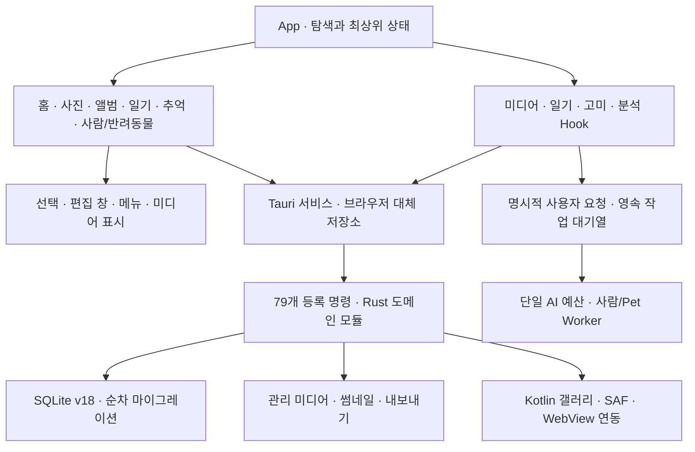

# 0.9.11 실제 구조 조사

기준 제품 소스 `655363a475c7748f57a819b44e835ff2ffd715f0`. 시작 시 GitHub 최신 커밋과 일치함을 확인했다. 원격 감사 브랜치의 기존 `e9ac2a4`, `292eb19` 테스트 변경을 보존했다. 운영 사진과 SQLite 파일은 사용하지 않았다.

## 화면과 상태

| 진입점 | 책임·상태·주요 데이터 경로 |
| --- | --- |
| `src/main.tsx` | StrictMode, 플랫폼 dataset, Android visualViewport 관찰, 공통 CSS 순서 |
| `App.tsx` | activeView, 사진 보기 모드/월/검색, 다중선택, 상세보기, 가져오기/앨범 초안; 화면 변경 시 선택 초기화 |
| `useMediaLibrary` | 미디어·앨범 로드, 가져오기 잠금, progress, revision을 통한 오래된 응답 차단, keyedTaskQueue 쓰기 직렬화, blob URL 해제 |
| `useMediaSelection`, `useMediaViewer` | 선택 ID 집합, 원본 미디어 ID 조회, 상세 목록/이전·다음 |
| `HomeView`, `useCharacters` | 호감도/이벤트, 고미 대사·포즈, 앱 첫 진입 안내 |
| `PhotoWorkspace`, `LibraryView` | grid/calendar/book, 검색·필터·정렬, 최대 48개 페이지, 즐겨찾기와 썸네일 |
| `AlbumsView`, `AlbumEditor`, `useAlbumReader` | 앨범 목록·편집, 글/챕터, 펼침/한 페이지, turnPhase·타이머 취소, reduced motion |
| `DiaryView`, `useDiary` | 초안·원본 비교, 저장 잠금/오류 보존, 날씨/감정, 사진 6장, 월·검색, 이동 |
| `MemoriesWorkspace` | 다시보기/타임라인/지도, 여행 발견, 날짜별 미디어 연결 |
| `MemoryMap`, `RegionGallery`, `RegionEditor` | 지역별 페이지 조회, 위치 없음과 실패 구분, 수동 지역·해외 지역 지정 |
| `PeopleWorkspace`, `PeopleView` | 사람·반려동물 탭 상태와 방문 시 Pet 마운트, 얼굴/수동 사진 관리, 이름·이동·제외·재분석 |
| `PetsView`, `PetPhotoSearch`, `usePetAnalysis` | 개체 등록과 연결, 사용자 확인, 수동 영역/방향, 영속 대기열, 명시적 시작·중단·재개 |
| `SettingsPanel` | 목록 비우기, DEV에서만 lazy 인식 평가 화면 |

## React / Rust / SQLite 경계

React가 선택·초안·진행 상태와 사용자 확인을 담당한다. 실제 파일 접근·복사·삭제·내보내기·썸네일·SQLite 쓰기는 Rust 명령에 둔다. 브라우저 검사는 `__TAURI_INTERNALS__` 대체 응답과 브라우저 일기 IndexedDB 경로를 별도로 구분했다. 대체 응답 성공은 실제 네이티브 저장 성공을 의미하지 않는다.

| Rust 모듈 | 책임 |
| --- | --- |
| `lib.rs`, `managed_import.rs`, `android_media.rs` | 앱 초기화, 명령 등록, 관리 파일 가져오기, 플랫폼 분기 |
| `database.rs`, `database_tests.rs` | `user_version=18`, Immediate transaction으로 마이그레이션, foreign keys/secure_delete, 미래 DB 거부 |
| `album_content.rs`, `diary.rs` | 앨범 글/사진 순서 및 일기·첨부 |
| `faces.rs`, `person_engine.rs`, `recognition.rs` | 얼굴·인물·수동 연결·분석 작업·특징/방향 저장; 구형 512 기록 보존과 활성 사용 차단 |
| `pets.rs`, `pet_recognition.rs`, `pet_jobs.rs` | 반려동물 개체·수동 연결·확인·외형·대기열 |
| `person_evaluation.rs`, `pet_evaluation.rs` | 독립 평가 자료와 결과 내보내기; 제품 정확도 보장과 구분 |
| `location.rs`, `characters.rs` | 위치와 지역 보정, 고미 호감도/이벤트/시작 데이터 |
| `thumbnails.rs`, `media_dimensions.rs`, `playback.rs`, `localhost.rs`, `export.rs` | 파생 이미지·미디어 재생·로컬 서버와 export |
| `native_ai.rs` | 별도 연구 특징 저장 계약; 제품의 미학습 모델 추론을 의미하지 않음 |

SQL 파일 36개 테이블 이름에는 `characters-six-stages.sql`의 교체용 `_v10` 임시 테이블도 포함되므로 실제 설치 DB의 테이블 개수로 해석하지 않는다. 마이그레이션 순서와 이력, 과거 특징·사용자 확인·사진 ID를 변경하지 않았다. 모델 제외를 이유로 테이블/행을 삭제하지 않았다.

## Worker·비동기·플랫폼

- `features/ai/runtime.ts`가 AI 도메인을 직렬화하며 도메인 전환 시 다른 Worker를 dispose한다. 중단된 호출의 외부 Promise와 실제 작업 종료 시점을 구분한다.
- 사람/Pet client가 Worker 메시지 ID·timeout·AbortSignal·idle dispose를 관리한다. 테스트 전용 native Worker는 앱 진입 그래프와 별개다.
- `usePetAnalysis`는 시작 시 대기열을 읽기만 한다. 가져오기·프로필 저장은 추론 권한을 부여하지 않는다. `start/retrain/resume`에서만 실행한다.
- Android: `GamjassakMediaPlugin.kt`, `GamjassakGalleryActivity.kt`, SAF/미디어 권한, 관리 복사 경로, `useAndroidBack`, visualViewport. Windows: 파일 dialog·NSIS·로컬 미디어 서버와 단일 인스턴스 분기. 브라우저 폭 변경으로 이 경로를 검증했다고 주장하지 않는다.
- 원본과 관리 복사본의 수명은 다르다. Android 앱 제거 시 앱 전용 저장소가 지워질 수 있다. 같은 앱 ID·유효한 동일 서명의 일반 업데이트와 제거 후 재설치는 같은 데이터 보존 시나리오가 아니다.

## 의존성과 CSS

직접 의존성은 모두 코드/빌드에서 참조된다. `motion/react`는 캐릭터, TFJS/COCO는 기본 Pet, FaceAPI는 128차원, fontsource는 일기 서체다. Vite·TypeScript·plugin-react는 빌드 도구이므로 화면에서 안 보인다는 이유로 삭제하지 않았다. 의존성 추가는 없다.

CSS는 main의 styles → design-system → albums/calendar → controls → 세부/brand → android → mobile-controls 순서와 기능 import가 함께 적용된다. 183개의 반복 선택자는 반응형/상태/의도적 계층을 포함하므로 일괄 삭제 근거가 아니다. 86개 미참조 후보도 문자열 기준의 후보일 뿐이며 자동 삭제하지 않았다. 실제 삭제·통합은 별도 CSS 보고서에 명시한다.

원자료: `evidence/inventory/gamjassak-module-graph.json`, `gamjassak-native-contracts.json`, `gamjassak-css-inventory.json`. 정적 그래프는 CSS 내부 import·JS 문자열 경로·제네릭 invoke의 완전한 분석기가 아니다. 테스트·스크립트·Rust 등록·SQL·플랫폼 파일을 수동 참조 검색으로 보완했다.
